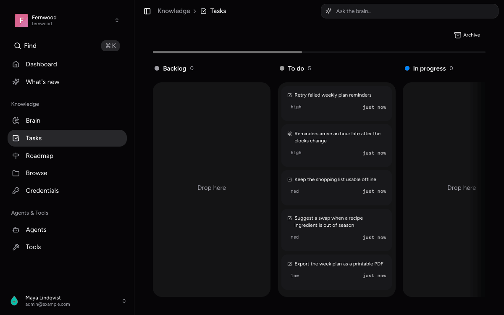
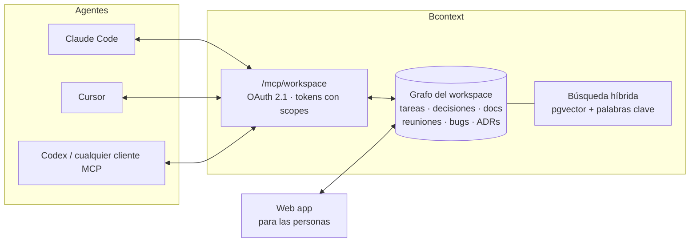

<div align="center">

<picture>
  <source media="(prefers-color-scheme: dark)" srcset="docs/images/logo-dark.svg">
  
</picture>

# Bcontext

**La memoria compartida que tus agentes de IA leen y escriben.**

Tareas, decisiones y documentos en un mismo workspace desde el que trabajan
Claude Code, Cursor, Codex y tu equipo, por [MCP](https://modelcontextprotocol.io).
Autoalojado, open source, un `docker compose up`.

[](https://github.com/Ibonarambarri/Bcontext/actions/workflows/ci.yml)
[](CHANGELOG.md)
[](LICENSE)
[](docs/connect-agents.md)
[](docs/self-hosting.md)

[Inicio rápido](#inicio-rápido) · [Ejemplos](examples) · [Conectar un agente](docs/connect-agents.md) · [Autoalojamiento](docs/self-hosting.md) · [Configuración](docs/configuration.md) · [Contribuir](CONTRIBUTING.md)

[English](README.md) · **Español**

<br>



</div>

> La documentación de `docs/` está en inglés. Este README es una traducción
> del [README en inglés](README.md); si difieren, manda el inglés.

## Por qué

Tu equipo ya trabaja con agentes, y cada sesión empieza de cero. Lo que un
agente decidió el lunes vive en un chat que nadie volverá a abrir. La
memoria está encerrada en cada herramienta, por persona. El siguiente
agente, en la máquina de otra persona y con otro modelo, contradice la
decisión de la semana pasada o rehace el trabajo.

Bcontext es el sitio donde ese trabajo queda. Un agente empieza pidiendo un
**brief**: qué está desbloqueado, qué decisiones siguen abiertas, qué ha
cambiado desde la última vez. Coge una tarea, hace el trabajo y la cierra
con un **`## Result`** sobre el que construye el siguiente agente o persona.
Las personas ven el mismo grafo en la web y lo dirigen: **What's new** lista
lo que agentes y compañeros cambiaron desde tu última visita, y **Ask the
brain…** responde desde el workspace citando los nodos de los que sale.
Escribir es cosa de tu agente.



## Cómo es una sesión

```text
tú     ▸ Coge la siguiente tarea de pagos.

agente ▸ brief()
         3 desbloqueadas · 1 decisión abierta · 7 cambios desde ayer
         ↳ "Retry failed webhook deliveries with backoff"   todo · high
         ↳ la decisión "Idempotency keys on every payment write" fue aceptada

agente ▸ nodes_write(update, status: in_progress)
         … escribe el código, respetando la decisión de idempotencia …
agente ▸ nodes_write(append, "## Result")
         Los reintentos usan pg-boss con backoff exponencial (5 intentos, máx. 1 h).
         Los mensajes fallidos acaban en la vista Ops. PR #142.
```

Mañana el agente de un compañero, en otro editor, empieza desde ese
resultado en lugar de desde cero.

## Características

- **🧠 Un grafo de conocimiento tipado.** Tareas, decisiones, ADRs, docs,
  reuniones, bugs, entidades, datasets y objetivos, con enlaces tipados
  (`blocked_by`, `supersedes`…), etiquetas jerárquicas, subtareas y un ciclo
  de estados. Cada encabezado `##` es un bloque direccionable
  (`/n/<id>#result`), así que los agentes editan una sección sin pisar otra.
- **🔌 Un servidor MCP pensado para agentes.** Un endpoint por workspace,
  OAuth 2.1 o tokens de agente con scopes, y un `tools/list` filtrado a lo
  que cada llamante puede hacer. Concurrencia optimista en las escrituras,
  un feed de cambios para resincronizar barato, y otros servidores MCP
  detrás de `capability_search` / `capability_call`: se registran una vez en
  Tools y se conceden por agente.
- **🔎 Recuperación que cita.** Búsqueda híbrida pgvector + palabras clave
  con expansión de un salto en el grafo. Las respuestas citan los nodos de
  los que salen. Funciona sin ninguna clave de IA (búsqueda por palabras
  clave), con Vercel AI Gateway o con cualquier servidor compatible con
  OpenAI, como Ollama o LiteLLM.
- **👥 Hecho para equipos, con registro de auditoría.** Workspaces con
  miembros, roles, invitaciones y permisos por principal. Cada escritura
  registra quién la hizo, persona o agente, en un log append-only con cadena
  de hashes. Un editor colaborativo para las personas.
- **🧩 Skills que comparten los agentes de todo el equipo.** Las skills son
  nodos: importa una desde un `SKILL.md` y cualquier agente conectado puede
  obtenerla como instrucciones para ejecutarla con su propio modelo. También
  pueden ejecutarse de forma programada, como el resumen semanal incluido.
- **🎙️ De reuniones a decisiones.** Pega la transcripción de una reunión y se
  convierte en un nodo de reunión; las decisiones, tareas y bugs que contiene
  se proponen en una bandeja de revisión que un agente o una persona acepta
  o descarta.
- **📈 Opcional: el negocio, no solo el código.** Un workspace también puede
  conocer un negocio SaaS o un marketplace: sus propios tipos de registro
  (`account`, `deal`, `zone`…), una API de ingesta de solo escritura a la que
  tu producto envía clientes y eventos, y métricas calculadas (MRR, churn,
  NRR, GMV, take rate y runway) para agentes y dashboards. Ver
  [docs/ingest-api.md](docs/ingest-api.md) y
  [docs/business-views.md](docs/business-views.md).

## Capturas

<table>
<tr>
<td width="50%"><br><sub><b>Grafo.</b> Cómo se conectan tareas, decisiones y docs.</sub></td>
<td width="50%"><br><sub><b>Tablero.</b> Tareas por estado, con el progreso de las subtareas.</sub></td>
</tr>
<tr>
<td><br><sub><b>Una tarea.</b> Las subtareas y el <code>## Result</code> que dejó un agente.</sub></td>
<td><br><sub><b>Cambios.</b> Quién escribió qué, persona o agente.</sub></td>
</tr>
</table>

## Inicio rápido

### Que lo instale tu agente

Pega esto en Claude Code, Codex, Cursor o cualquier agente con shell:

```text
Install Bcontext (https://github.com/Ibonarambarri/Bcontext) on this machine.
Follow https://raw.githubusercontent.com/Ibonarambarri/Bcontext/main/docs/install-with-an-agent.md
step by step: clone or update the repo, configure it, start it, wait until it
is healthy, then connect yourself to my workspace over MCP. Ask me only for
what you cannot decide.
```

Comprueba Docker, te pregunta dónde debe correr y tu email, escribe la
configuración, arranca el stack y, cuando hayas creado tu cuenta, se conecta
por MCP. Los pasos que sigue están en
[docs/install-with-an-agent.md](docs/install-with-an-agent.md).

### O a mano

Necesitas Docker con Compose v2, `openssl` y unos 4 GB de RAM libre para
compilar (el stack en marcha usa menos de 1 GB).

```bash
git clone https://github.com/Ibonarambarri/Bcontext.git bcontext && cd bcontext && make up ADMIN_EMAIL=tu@ejemplo.com
```

`make up` escribe `.env` con secretos nuevos (`./setup.sh`; `ADMIN_EMAIL`
puede abrir `/admin`), ejecuta `docker compose up -d` y espera a que la
instancia esté sana. Abre <http://localhost:8080>, crea tu cuenta y tu primer
workspace en `/start`, y ya estás dentro. Sin `make`:

```bash
./setup.sh --domain localhost --admin-email tu@ejemplo.com -y
docker compose up -d     # y abre http://localhost
```

Las imágenes vienen precompiladas desde GHCR para amd64 y arm64; el primer
`up` solo las compila desde el código cuando no hay imagen publicada, y
entonces tarda unos minutos. ¿El puerto 80 está ocupado? Añade
`--http-port 8080` a `setup.sh`.

En un servidor con dominio propio, Caddy obtiene el certificado HTTPS
automáticamente: ver [docs/self-hosting.md](docs/self-hosting.md) para DNS,
email, el backend de IA, copias de seguridad y actualizaciones.

## Conecta tu agente

En la web, **Agents → Add agent** te da un snippet listo para pegar en cada
cliente. Para Claude Code a mano:

```bash
claude mcp add --transport http bcontext https://tu-host/mcp/<workspace>
```

Claude Code abre el navegador para aprobar la conexión (OAuth). Para el
plugin, que añade las convenciones de trabajo como skill y un comando
`/bcontext:brief`, y para Cursor, Codex y autenticación por token, ver
[docs/connect-agents.md](docs/connect-agents.md).

## Tu primera llamada

No necesitas cliente: cada herramienta es una llamada JSON-RPC por HTTP.
Crea un token en **Agents → Add agent → API key** y pide el brief:

```bash
export BCONTEXT_TOKEN=bctx_live_…
curl -s http://localhost:8080/mcp/<workspace> \
  -H "Authorization: Bearer $BCONTEXT_TOKEN" \
  -H "Content-Type: application/json" -H "Accept: application/json, text/event-stream" \
  -d '{"jsonrpc":"2.0","id":1,"method":"tools/call","params":{"name":"brief","arguments":{}}}'
```

En [examples/](examples) está el bucle completo (brief → coger una tarea →
cerrarla con un `## Result`) con curl y con el SDK de MCP para TypeScript,
una skill compartida y configuraciones de cliente para Claude Code, Cursor y
Codex.

## Comparativa

Bcontext se sitúa entre los sitios donde los equipos guardan hoy el contexto
de sus agentes. No sustituye a tu gestor de issues ni a la memoria propia de
tu editor: es la capa compartida en la que los agentes escriben mientras
trabajan.

| | Ficheros en el repo (`CLAUDE.md`, `AGENTS.md`, reglas) | Un gestor de issues por MCP (Linear, Jira, GitHub Issues) | Bcontext |
|---|---|---|---|
| Compartido entre personas, máquinas y herramientas | vía git | ✅ | ✅ |
| Tareas, decisiones y ADRs tipados con estado y dependencias | — | tareas, sí | ✅ |
| Escrito por agentes a mitad de tarea, sección a sección | edición del fichero entero | comentarios | bloques `##`, `if_updated_at`, `## Result` |
| Una lectura para empezar la sesión (`brief`) y un feed de cambios | — | — | ✅ |
| Quién escribió qué, persona o agente, por token | git blame | por usuario | ✅ log de auditoría con cadena de hashes |
| Autoalojado, tus datos | ✅ | depende del producto | ✅ |

## Hoja de ruta

Bcontext se mantiene en la medida de lo posible, así que esto son las
carencias conocidas que toca cerrar, no promesas con fecha:

- **Embeddings que no sean de 1536 dimensiones**: hoy la búsqueda semántica
  necesita un modelo de 1536 dimensiones, así que muchos modelos locales se
  quedan en búsqueda por palabras clave
  ([docs/self-hosting.md](docs/self-hosting.md)).
- **Reindexado más seguro**: que un nodo conserve sus filas de búsqueda si no
  se puede guardar un embedding nuevo.
- **Más ejemplos**: un cliente en Python y configuraciones para más clientes
  MCP.
- **Releases en GitHub** con las notas del [changelog](CHANGELOG.md) para cada
  tag.

Las ideas y propuestas grandes empiezan por un
[issue](https://github.com/Ibonarambarri/Bcontext/issues/new/choose).

## Arquitectura

<details>
<summary>Un proyecto <code>docker compose</code> en una sola máquina. Caddy es el único servicio con puertos publicados.</summary>

<br>

| Servicio | Qué ejecuta |
|---|---|
| `caddy` | Un único origen para todo: la web, la API, `/mcp` y el gateway de Supabase, con HTTPS automático |
| `web` | La app Next.js (`apps/web`). No tiene datos propios y llama a la API por HTTP |
| `api` | REST, el servidor MCP y WebSockets en tiempo real (`apps/api`) |
| `worker` | Colas pg-boss: webhooks salientes, health checks de servidores MCP y caducidad OAuth, skills programadas, agregados de métricas de negocio, retención (misma imagen que `api`) |
| `migrate` | De un solo uso: aplica las migraciones pendientes y termina; `api` y `worker` lo esperan |
| `db` | Postgres 15 con pgvector (`supabase/postgres`) |
| `auth`, `rest`, `storage`, `kong` | Supabase Auth, PostgREST, Storage (ficheros en un volumen) y su gateway |
| `errors` *(perfil)* | Colector de errores opcional tras `/admin/errors` |
| `studio`, `meta` *(perfil)* | Supabase Studio opcional en `127.0.0.1` |

```
apps/api            API, servidor MCP, worker, colector de errores, migraciones (una imagen)
apps/web            web app Next.js
packages/contract   tipos y helpers que comparten ambas apps
deploy/             Caddyfile, gateway e init SQL de Supabase, runner de migraciones
plugin/             plugin de Claude Code: skill de convenciones y /bcontext:brief
examples/           ejemplos ejecutables: el bucle del agente, una skill, configs de cliente
docker-compose.yml  el stack autoalojado
setup.sh            escribe .env con secretos nuevos
Makefile            atajos: make up, make verify, make examples
```

**Stack:** TypeScript · Hono · Next.js 16 · React 19 · Postgres + pgvector ·
Supabase Auth/Storage · pg-boss · Vercel AI SDK · HeroUI · Caddy

</details>

## Estado del proyecto

Bcontext nació como producto comercial y ahora se publica como open source
para quien quiera ejecutarlo. Ha estado en producción y funciona de punta a
punta, pero se mantiene en la medida de lo posible: los issues y pull
requests son bienvenidos, sin compromisos de tiempo de respuesta.

## Contribuir

Empieza por [CONTRIBUTING.md](CONTRIBUTING.md) (en inglés):
`make install && make verify` es toda la preparación para cambios de código.
Los issues con la etiqueta
[`good first issue`](https://github.com/Ibonarambarri/Bcontext/labels/good%20first%20issue)
están acotados para un primer PR. Los agentes que trabajen en el código,
empezad por [AGENTS.md](AGENTS.md). Sigue el
[Código de Conducta](CODE_OF_CONDUCT.md) e informa de los problemas de
seguridad en privado ([SECURITY.md](SECURITY.md)).

## Licencia

[GNU Affero General Public License v3.0](LICENSE) (`AGPL-3.0-only`). Puedes
usarlo, modificarlo y autoalojarlo libremente. Si ofreces un Bcontext
modificado como servicio en red, debes ofrecer su código fuente a sus
usuarios.
